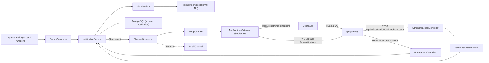
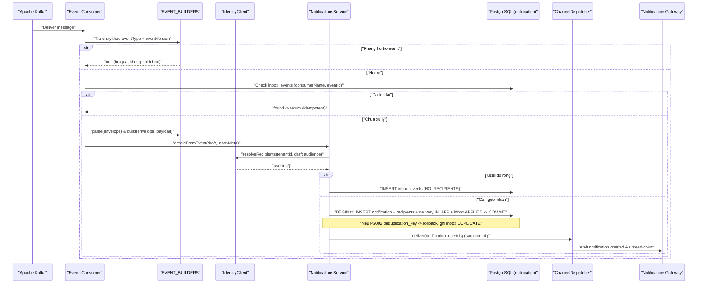

# Thiết kế `notification-service`: Ingest sự kiện, WebSocket realtime & Admin Broadcast

## 1. Trạng thái & căn cứ

**Trạng thái:** Proposed — chờ duyệt (tài liệu thiết kế trước khi viết plan triển khai; chưa sửa mã nguồn, schema hay migration).

Các nguồn thẩm quyền mà thiết kế này bám theo:

- **Business authority (BRD):** `docs/plan_ghi_ro_so_task_backlog/brd.md` — `BR-NOT-001` (sự kiện kích hoạt thông báo), `FR-NOT-001` (Notification center và trạng thái read/unread), `NFR-REL-001` (idempotency chống trùng thông báo), mục 10 (event envelope).
- **Service boundaries:** `docs/architecture/service-boundaries.md` §3.7 (`notification-service` chỉ sở hữu notification records, read/archive state và delivery state; không phải nguồn sự thật nghiệp vụ).
- **Data ownership & Database:** `docs/architecture/data-ownership.md` và `docs/architecture/database-design.md` §11 (`logix_notification`, schema `notification` gồm `notifications`, `notification_recipients`, `notification_deliveries`, `inbox_events`).
- **Event architecture:** `docs/architecture/event-architecture.md` §5 (idempotency) và §7 (retry & failure handling).
- **Code & Quality standards:** `AGENTS.md` (no hardcoding, fail fast, fail closed, thông báo lỗi tiếng Việt, cấu trúc `controller -> service -> domain/repository`).

> **Ghi chú mở rộng phạm vi:** Trung tâm gửi thông báo chủ động cho Admin (Admin broadcast) là phần mở rộng ngoài BRD hiện tại, cần chủ dự án chấp nhận khi chốt thiết kế (xem §12).

---

## 2. Phạm vi

### 2.1 Có trong bản thiết kế này

1. **Thông báo hệ thống từ Kafka (3 sự kiện đang có producer thật):**

| Sự kiện & Version | Topic nguồn | Producer | Người nhận | Khóa chống trùng (`deduplication_key`) | Ghi chú hợp đồng thực tế |
|---|---|---|---|---|---|
| `OrderPendingStock` v1 | `KAFKA_ORDER_TOPIC` | `order-service` | Quyền `order:sales-order:read` | `OrderPendingStock:{orderId}:{aggregateVersion}` | Payload (`order-reservation.service.ts`) có `orderId`, `warehouseId`, `pendingSince`, `shortageItems`; **không** có `orderNumber` nên template dùng nội dung tổng quát kèm `orderId` trong `data`. |
| `DeliveryFailed` v2 | `KAFKA_TRANSPORT_TOPIC` | `transport-service` | Quyền `transport:trip:dispatch` | `DeliveryFailed:{stopId}:{attempt}` | Dùng `deliveryResultEventSchema` từ `@logix/messaging`; trường định danh điểm dừng trong Zod schema là `stopId`. |
| `TripDispatched` v2 | `KAFKA_TRANSPORT_TOPIC` | `transport-service` | `payload.assigneeUserId` (tài xế được gán) | `TripDispatched:{tripId}:{aggregateVersion}` | Dùng `tripDispatchedEventV2Schema` từ `@logix/messaging`; payload **đã có sẵn** `assigneeUserId` (từ `trip.driverUserId`). |

2. **Notification Center REST API:** liệt kê hộp thư cá nhân (cursor), đếm số chưa đọc (`unread-count`), đánh dấu đã đọc (`read`, `read-all`), lưu trữ (`archive`).
3. **WebSocket realtime:** đẩy thông báo mới và cập nhật `unread-count` tức thời qua Socket.IO.
4. **Admin broadcast:** trung tâm cho phép admin/người có quyền chủ động soạn và gửi thông báo ngay tới người dùng trong tenant, kèm danh sách lịch sử và thống kê đã đọc.

### 2.2 Để sau (Ngoài phạm vi MVP)

- **Kênh `EMAIL` / `PUSH`:** đã chừa interface `NotificationChannel` và bảng `notification_deliveries` (hỗ trợ `EMAIL`, `PUSH` qua check constraint), nhưng chưa tích hợp SMTP/FCM trong đợt này (xem §7.2).
- **Hẹn giờ gửi hoặc thu hồi (schedule/revoke) broadcast:** Admin broadcast chỉ hỗ trợ gửi ngay.
- **Cảnh báo tồn kho thấp (`LowStockDetected`):** `inventory-service` chưa phát event này lên Kafka.
- **`ForecastCompleted` & `AI job failed`:** `forecast-service` mới ghi outbox trong DB chưa có relay lên Kafka; `agent-service` chưa phát event lên Kafka.
- **Tùy chọn bật/tắt thông báo theo từng user (preferences/mute).**
- **Scale WebSocket nhiều instance:** bản đầu chạy 1 replica; khi scale ngang cần gắn `@socket.io/redis-adapter`.

---

## 3. Kiến trúc tổng quan

Thiết kế theo cấu trúc NestJS chuẩn của các service khác trong LogiX (`controller -> service -> prisma` kết hợp `integrations/*.client.ts`), giữ module gọn nhẹ, không chia tầng Ports & Adapters rườm rà.



**Nguyên tắc cốt lõi:** **Database là nguồn sự thật của hộp thư; WebSocket chỉ là kênh đẩy.** Nếu client mất kết nối hoặc offline tại thời điểm phát sự kiện, thông báo vẫn nằm an toàn trong PostgreSQL; khi reconnect, client gọi REST API để đồng bộ lại danh sách và `unread-count`.

---

## 4. Cấu trúc module

Tổ chức phẳng dưới `apps/notification-service/src/`, tương đồng với `order-service` và `transport-service`:

```text
apps/notification-service/src/
├── main.ts                                  # Bootstrap, đọc PORT qua ConfigService.getOrThrow
├── app.module.ts                            # Root module, GlobalExceptionFilter, Config, Logger
├── config/
│   └── notification-config.schema.ts        # Zod schema fail-fast cho toàn bộ env
├── auth/
│   ├── auth.module.ts                       # PassportModule + JwtStrategy + Guards
│   └── jwt.strategy.ts                      # Verify JWT bằng JWT_SECRET (theo transport-service)
├── database/
│   ├── database.module.ts
│   └── prisma.service.ts
├── integrations/
│   └── identity.client.ts                   # Gọi identity internal API bằng internal JWT
├── notifications/
│   ├── notification.constants.ts            # Type, severity, channel, status, outcome, page size, limits
│   ├── notification-templates.ts            # Tiêu đề/nội dung tiếng Việt theo type
│   ├── notifications.controller.ts          # Inbox REST của user (/api/v1/notifications)
│   ├── notifications.service.ts             # Create + fan-out + list/read/archive + gọi dispatcher sau commit
│   └── dto/
│       └── list-notifications.query.ts
├── events/
│   ├── event-builders.ts                    # Map Record<eventType, { version, producer, parse, build }>
│   ├── events.consumer.ts                   # Check inbox dedupe + gọi builder + NotificationService
│   └── events.module.ts                     # Đăng ký 2 KafkaEventConsumer (order, transport)
├── realtime/
│   └── notifications.gateway.ts             # Socket.IO gateway, xác thực JWT, quản lý room theo user
├── channels/
│   ├── notification-channel.ts              # Interface NotificationChannel
│   ├── in-app.channel.ts                    # Đẩy realtime qua NotificationsGateway
│   └── channel-dispatcher.ts                # Điều phối các channel đang bật sau khi DB commit
└── admin/
    ├── admin-broadcast.controller.ts        # REST admin broadcast (/api/v1/notifications/admin/broadcasts)
    ├── admin-broadcast.service.ts
    └── dto/
        ├── create-broadcast.dto.ts
        └── list-broadcasts.query.ts
```

---

## 5. Các quyết định thiết kế giữ lại (và lý do)

| Quyết định | Áp dụng ở đâu | Lý do & Ràng buộc |
|---|---|---|
| **Inbox + `deduplication_key`** | `events.consumer.ts`, `notifications.service.ts` | Bắt buộc theo `NFR-REL-001` và `event-architecture.md` §5. Kiểm tra `inbox_events` (`consumer_name, event_id`) ngay trong `events.consumer.ts` (không tách class `InboxGuard` riêng); dựa vào unique index `ux_notification_event_recipient_scope` và bắt `P2002` xem như `DUPLICATE`. |
| **Map builder theo `eventType`** | `events/event-builders.ts` | Dùng một object `EVENT_BUILDERS` thay cho bộ class `HandlerRegistry` + `Strategy`. Thêm event mới chỉ cần thêm 1 entry. Mỗi builder validate envelope và payload bằng Zod (tái dùng `deliveryResultEventSchema`, `tripDispatchedEventV2Schema` từ `@logix/messaging`). |
| **Interface `NotificationChannel`** | `channels/notification-channel.ts` | Là abstraction duy nhất được giữ lại để đáp ứng yêu cầu mở rộng sang `EMAIL` và các kênh khác sau này mà không sửa core `NotificationsService`. |
| **Fan-out lúc ghi** | `notifications.service.ts` | Resolve người nhận thành danh sách `USER` và ghi vào `notification_recipients` ngay lúc tạo thông báo, giúp query inbox và đếm unread dùng thẳng partial index `ix_recipient_unread`. |
| **Đẩy realtime sau commit** | `notifications.service.ts` + `ChannelDispatcher` | Chỉ gọi `ChannelDispatcher` **sau khi** `Prisma.$transaction` đã commit thành công, tránh client nhận được thông báo nhưng DB rollback. Nếu push WebSocket lỗi thì chỉ log warning, không rollback DB. |

Interface `NotificationChannel`:

```typescript
export interface NotificationChannel {
  readonly channel: 'IN_APP' | 'EMAIL';
  deliver(notification: NotificationView, recipientUserId: string): Promise<void>;
}
```

**Những gì đã lược bỏ so với bản thiết kế trước:**
Bỏ toàn bộ kiến trúc Hexagonal/Ports cho `IdentityClient` (gọi trực tiếp class client như các service khác), bỏ `HandlerRegistry` class, bỏ `InboxGuard` class riêng, bỏ `NotificationDraft` Value Object/Factory phức tạp, bỏ mô hình Template Method/Pipeline trừu tượng và bỏ việc tách đôi `QueryService`/`CommandService`. Lý do: quy mô `notification-service` gọn, mỗi phần chỉ có một implementation thực tế, giữ cấu trúc phẳng sẽ nhất quán với toàn bộ repo NestJS hiện tại.

---

## 6. Luồng xử lý

### 6.1 Luồng ingest sự kiện từ Kafka



### 6.2 Xử lý lỗi & retry

| Tình huống | Hành vi | Trạng thái `inbox_events` |
|---|---|---|
| Lỗi tạm thời (DB mất kết nối, `identity-service` 5xx/timeout) | Throw lỗi để `KafkaEventConsumer` giữ nguyên offset và thử lại. | Không ghi |
| Payload hoặc envelope sai schema vĩnh viễn (lỗi Zod, sai `producer`, lệch `tenantId`/`aggregateId`) | Ghi `inbox_events` `REJECTED_INVALID` kèm `errorCode`, log error (`eventId`, `tenantId`, `correlationId`), rồi ack để không chặn partition. *(Quyết định mặc định, chờ duyệt)* | `REJECTED_INVALID` |
| Không tìm thấy user nhận hợp lệ (`userIds.length === 0`) | Không tạo notification, ack offset. | `NO_RECIPIENTS` |
| Trùng `deduplication_key` (`P2002` trên `ux_notification_event_recipient_scope`) | Rollback transaction tạo notification, ghi inbox `DUPLICATE`, ack offset. | `DUPLICATE` |

### 6.3 Trạng thái recipient (`read_at` và `archived_at`)

`read_at` và `archived_at` là hai timestamp độc lập trên bảng `notification_recipients`. Các thao tác `read` và `archive` đều idempotent (nếu đã gán timestamp thì giữ nguyên thời điểm cũ). Khi một thông báo chưa đọc bị `archive`, `archived_at` khác `NULL` nên tự động rơi khỏi partial index `ix_recipient_unread` (`WHERE read_at IS NULL AND archived_at IS NULL`) và không còn tính vào `unread-count`.

---

## 7. WebSocket realtime & hướng mở rộng kênh

### 7.1 Thiết kế WebSocket (`NotificationsGateway`)

- **Công nghệ:** Socket.IO (`@nestjs/websockets`, `@nestjs/platform-socket.io`), namespace `/notifications`, path `/ws/notifications`. Chọn Socket.IO thay vì `ws` thuần vì hỗ trợ sẵn room, tự động reconnect và truyền auth token trong handshake.
- **Xác thực & Fail-closed:**
  - Client gửi access token qua `handshake.auth.token`.
  - Khi kết nối (`handleConnection`), gateway verify chữ ký bằng `JWT_SECRET` và chuẩn hóa user qua hàm `accessTokenUser` (`@logix/auth`). Thiếu token hoặc token hết hạn/sai chữ ký → `client.disconnect(true)` ngay lập tức.
  - Đặt timer theo thời điểm `exp` của token để tự động ngắt kết nối khi hết hạn; client chủ động reconnect với token mới đã refresh.
- **Quản lý Room:** Server tự join socket vào room `tenant:{tenantId}:user:{userId}`. Không dùng room chung toàn tenant để client tự join và không cho phép client gửi yêu cầu chọn/chuyển room.
- **Sự kiện Server → Client:**
  - `notification.created`: payload là `NotificationItemDto`.
  - `notification.unread-count`: payload `{ count: number }`, phát khi có thông báo mới, hoặc khi user thực hiện `read` / `read-all` / `archive` qua REST để đồng bộ trạng thái giữa nhiều tab trình duyệt.
- **Client → Server:** Không nhận lệnh ghi trạng thái qua WebSocket. Mọi thao tác `read` / `read-all` / `archive` đều đi qua REST API nhằm giữ duy nhất một luồng authorization và validation.
- **Lưu ý tích hợp `api-gateway` (Pitfall khi triển khai):** Hiện tại `api-gateway` proxy các service nghiệp vụ với `ws: false` (chỉ `auth-proxy` có `ws: true`) và `apps/api-gateway/src/main.ts` chưa gắn `server.on('upgrade', ...)`. Khi triển khai cần tạo proxy riêng cho đường dẫn `/ws/notifications` với `ws: true` và móc sự kiện HTTP `upgrade` của Express/Nest HTTP server vào proxy đó.
- **Giới hạn bản đầu:** Chạy 1 replica `notification-service`. Khi mở rộng nhiều replica, gắn `@socket.io/redis-adapter` trỏ vào Redis (đã có trong hạ tầng `docker-compose`).

### 7.2 Hướng mở rộng kênh `EMAIL` (và `PUSH`)

- Viết `EmailChannel` implement `NotificationChannel` và đăng ký vào `ChannelDispatcher`.
- Thay vì đặt trạng thái `SENT` ngay như `InAppChannel`, `NotificationsService` tạo bản ghi `notification_deliveries` với `channel = 'EMAIL'`, `status = 'PENDING'`.
- Chạy background worker định kỳ quét `notification_deliveries` qua partial index `ix_delivery_retry` (`WHERE status IN ('PENDING', 'RETRY')`), gửi mail và cập nhật `attempt_count`, `next_attempt_at` (exponential backoff) hoặc `SENT`/`FAILED`.
- Khi cần gửi email, mở rộng `IdentityClient` để trả kèm địa chỉ email của danh sách người nhận; phần template HTML cho email tách ở giai đoạn triển khai kênh mail.

---

## 8. Trung tâm gửi thông báo cho admin (Admin Broadcast)

### 8.1 Phân quyền

Bổ sung 2 permission code chuẩn định dạng `module:resource:action` vào `@logix/auth` (`permission-codes.ts`) và seed của `identity-service`:
- `notification:broadcast:send` — gửi thông báo broadcast.
- `notification:broadcast:read` — xem lịch sử broadcast và thống kê đã đọc.

Controller gắn `@UseGuards(JwtAuthGuard, PermissionsGuard)` và `@RequirePermissions(...)`; thiếu quyền trả `403 Forbidden`.

### 8.2 API Endpoints (prefix `/api/v1/notifications/admin/broadcasts`)

| Method & Path | Đầu vào | Response & Hành vi |
|---|---|---|
| `POST /` | Header bắt buộc: `Idempotency-Key` (UUID)<br>Body: `{ title, body, severity, audience, link? }` | `201 Created`: `{ id, recipientCount }`. Gửi lặp lại cùng `Idempotency-Key` trong cùng tenant trả lại kết quả cũ (dựa trên `deduplicationKey = ADMIN_BROADCAST:{key}`). |
| `GET /` | Query: `cursor?`, `limit?` | `200 OK`: `{ items: AdminBroadcastSummaryDto[], nextCursor }`. Danh sách broadcast đã gửi trong tenant (`createdAt DESC, id DESC`), gồm `{ id, title, severity, audience, senderId, createdAt, recipientCount, readCount }`. |
| `GET /:id` | Param `:id` (UUID) | `200 OK`: chi tiết nội dung broadcast, `audience`, `senderId`, `recipientCount`, `readCount` (404 nếu không thuộc tenant). |

**Ràng buộc validation DTO:**
- `title`: chuỗi khác rỗng, tối đa 200 ký tự (khớp cột `VarChar(200)`).
- `body`: chuỗi khác rỗng, tối đa `MAX_BROADCAST_BODY_LENGTH` (named constant, ví dụ 4000 ký tự).
- `severity`: `INFO | WARNING | CRITICAL`.
- `audience`: discriminated union gồm 3 loại:
  - `{ kind: 'ALL' }` — toàn bộ thành viên active trong tenant.
  - `{ kind: 'ROLES', roleIds: string[] }` (mảng UUID không rỗng).
  - `{ kind: 'USERS', userIds: string[] }` (mảng UUID không rỗng).
- `link?`: tùy chọn, phải là đường dẫn nội bộ bắt đầu bằng `/` (không chấp nhận `http://`, `https://`, `javascript:` để tránh open redirect/XSS).

### 8.3 Lưu trữ & Kiểm soát an toàn

- **Lưu trữ không cần migration mới:** Một broadcast là 1 dòng trong `notifications` với `type = 'ADMIN_BROADCAST'`, `entity_type = null`, `entity_id = null`, `data = { senderId, audience, link }`. Các chỉ số `recipientCount` và `readCount` tổng hợp trực tiếp từ `notification_recipients` theo `notification_id`.
  - *Đánh đổi:* chưa có cột `created_by` riêng trên bảng `notifications`; nếu sau này có nhu cầu lọc/index danh sách broadcast theo người gửi thì bổ sung migration thêm cột sau.
- **Kiểm soát tenant & giới hạn:**
  - `IdentityClient` resolve `audience` và chỉ giữ các user đang `ACTIVE` thuộc đúng `tenantId` của admin (ID user/role ngoài tenant bị loại bỏ). Nếu tập người nhận sau resolve rỗng → trả `422 Unprocessable Entity`.
  - Giới hạn số người nhận mỗi lần broadcast qua constant `MAX_BROADCAST_RECIPIENTS` (đề xuất 5000); vượt ngưỡng trả `422`.
  - Ghi log cấu trúc gồm `tenantId`, `actorId`, `broadcastId`, `recipientCount` (không log `body`). Khi `audit-service` sẵn sàng, phát kèm audit event cho hành động gửi broadcast.
- **Tái sử dụng đường ghi chung:** `AdminBroadcastService` gọi `NotificationsService.createAndDispatch(...)` giống luồng sự kiện Kafka, nên broadcast tự động được đẩy realtime qua WebSocket (và sẵn sàng đi qua `EMAIL` khi mở rộng).

---

## 9. Hợp đồng REST Inbox của người dùng

Prefix qua Gateway: `/api/v1/notifications`. Các hằng số phân trang: `DEFAULT_NOTIFICATION_PAGE_SIZE = 20`, `MAX_NOTIFICATION_PAGE_SIZE = 100`. Mọi endpoint chỉ cần `@UseGuards(JwtAuthGuard)`, luôn ép điều kiện `tenantId = user.tenantId`, `recipientType = 'USER'`, `recipientId = user.id`, `deletedAt = null`. Trả **`404 Not Found`** nếu `:id` không thuộc user/tenant hiện tại. Phản hồi lỗi theo `@logix/errors` (tiếng Việt).

| Method & Path | Query / Param | Response | Hành vi |
|---|---|---|---|
| `GET /api/v1/notifications` | `cursor?`, `limit?` (1..100), `unreadOnly?`, `includeArchived?` (default `false`) | `200`: `{ items: NotificationItemDto[], nextCursor }` | Sắp xếp `createdAt DESC, id DESC`; `cursor` mã hóa `base64url` của `{ createdAt, id }` (sai định dạng → 400). |
| `GET /api/v1/notifications/unread-count` | — | `200`: `{ count: number }` | Dùng partial index `ix_recipient_unread` (`read_at IS NULL AND archived_at IS NULL`). |
| `PATCH /api/v1/notifications/:id/read` | `:id` (`notification_id`) | `204 No Content` | Idempotent; sau commit đẩy `notification.unread-count` qua WS. |
| `POST /api/v1/notifications/read-all` | — | `200`: `{ updated: number }` | Đánh dấu đọc tất cả mục chưa đọc & chưa archive của user; đẩy `notification.unread-count` qua WS. |
| `PATCH /api/v1/notifications/:id/archive` | `:id` (`notification_id`) | `204 No Content` | Idempotent; đẩy `notification.unread-count` qua WS. |

Shape `NotificationItemDto`:

```typescript
export interface NotificationItemDto {
  id: string;
  type: string;
  severity: string;
  title: string;
  body: string;
  entityType: string | null;
  entityId: string | null;
  link: string | null;        // Lấy từ data.link (broadcast) hoặc suy ra từ entityType/entityId
  data: Record<string, unknown>;
  createdAt: string;
  readAt: string | null;
  archivedAt: string | null;
}
```

---

## 10. Hợp đồng tích hợp

### 10.1 `identity-service` (endpoint nội bộ mới)

- **Endpoint:** `POST /internal/recipients/resolve`
- **Xác thực:** `@UseGuards(InternalServiceGuard)` + `@AllowInternalCallers(ServiceId.NOTIFICATION_SERVICE)` (mẫu `apps/identity-service/src/driver-users/driver-users.controller.ts`). `tenantId` đọc từ internal service token claim (không nhận từ body để tránh lệch tenant).
- **Request body:**
  ```typescript
  { audience: { kind: 'PERMISSION'; code: string } | { kind: 'ROLES'; roleIds: string[] } | { kind: 'USERS'; userIds: string[] } | { kind: 'ALL' } }
  ```
- **Response:** `200 OK` `{ userIds: string[] }`.
- **Quy tắc lọc:** chỉ trả user thỏa `user.status = 'ACTIVE'`, `userTenant.status = 'ACTIVE'`, `tenant.status = 'ACTIVE'`, các bản ghi đều `deletedAt IS NULL`. Với `kind: 'PERMISSION'`, chính sách mặc định bao gồm cả `OWNER` và role có wildcard `'*'` (tương tự `eligibleDriverUserWhere` tại `driver-users.service.ts`).

### 10.2 `api-gateway`

- Thêm `NotificationProxyMiddleware` cho REST `/api/v1/notifications` và `/api/v1/notifications/*`.
- Thêm proxy WebSocket `/ws/notifications` (`ws: true`) và gắn `server.on('upgrade', ...)` trong `apps/api-gateway/src/main.ts`.
- Bổ sung `NOTIFICATION_SERVICE_URL: z.string().url()` vào `gatewayConfigSchema`.

### 10.3 Apache Kafka & Biến môi trường

- **Kafka Consumers:** `EventsModule` khởi tạo 2 `KafkaEventConsumer` (`@logix/messaging`) với group ID `${KAFKA_GROUP_ID}.notification.order-events` (topic `KAFKA_ORDER_TOPIC`) và `${KAFKA_GROUP_ID}.notification.transport-events` (topic `KAFKA_TRANSPORT_TOPIC`).
- **Biến môi trường bắt buộc (`notification-config.schema.ts`):** `DATABASE_URL`, `PORT`, `SERVICE_NAME`, `KAFKA_BROKERS`, `KAFKA_CLIENT_ID`, `KAFKA_GROUP_ID`, `KAFKA_ORDER_TOPIC`, `KAFKA_TRANSPORT_TOPIC`, `JWT_SECRET`, `INTERNAL_SERVICE_JWT_SECRET`, `IDENTITY_SERVICE_URL`, `WS_CORS_ORIGINS`. Sửa `apps/notification-service/src/main.ts` để đọc `PORT` bằng `ConfigService.getOrThrow`, bỏ `process.env.PORT ?? ...`.

---

## 11. Kiểm thử

- **Unit tests:** `EVENT_BUILDERS` (payload hợp lệ, sai schema, sai `producer`, lệch `tenantId`/`aggregateId`), validate DTO admin broadcast (title/body length, link nội bộ).
- **Consumer tests:** replay cùng `eventId`, trùng `deduplicationKey` (`DUPLICATE`), không có người nhận (`NO_RECIPIENTS`), `IdentityClient` lỗi mạng/5xx phải throw để giữ offset.
- **REST Inbox E2E:** `401` khi thiếu/sai JWT, user chỉ thấy hộp thư của mình trong đúng tenant, trả `404` khi thao tác notification của user/tenant khác.
- **Admin Broadcast E2E:** `403` khi thiếu `notification:broadcast:send`/`read`, idempotency khi lặp `Idempotency-Key`, vượt `MAX_BROADCAST_RECIPIENTS` trả `422`.
- **WebSocket E2E (`socket.io-client`):** token sai/thiếu bị disconnect; user A không nhận được event của user B hoặc tenant khác; nhận `notification.created` và `notification.unread-count` ngay sau commit DB.
- **Kafka Integration E2E:** bắn sự kiện thật qua Kafka broker (theo mẫu `fulfillment-service`) và kiểm tra dữ liệu DB.
- **Repo gate:** `pnpm lint`, `pnpm typecheck`, `pnpm test`, `pnpm build`.

---

## 12. Câu hỏi cần chủ dự án chốt

1. Chấp nhận **Admin broadcast** là phần mở rộng ngoài BRD hiện tại, kèm 2 permission mới `notification:broadcast:send` và `notification:broadcast:read`?
2. Audience của broadcast có cần thêm `{ kind: 'PERMISSION', code }` không, hay chỉ cần `ALL` / `ROLES` / `USERS`?
3. Ngưỡng giới hạn `MAX_BROADCAST_RECIPIENTS = 5000` cho mỗi lần gửi broadcast có phù hợp?
4. Khi event Kafka sai schema vĩnh viễn, chốt phương án ghi `inbox_events` với `outcome = 'REJECTED_INVALID'` + log lỗi rồi **ack** (mặc định, để không nghẽn partition)?
5. Người dùng có vai trò `OWNER` (hoặc quyền `'*'`) có mặc định nhận các thông báo hệ thống phân giải theo `PERMISSION` không? (Mặc định đề xuất: **Có**).
