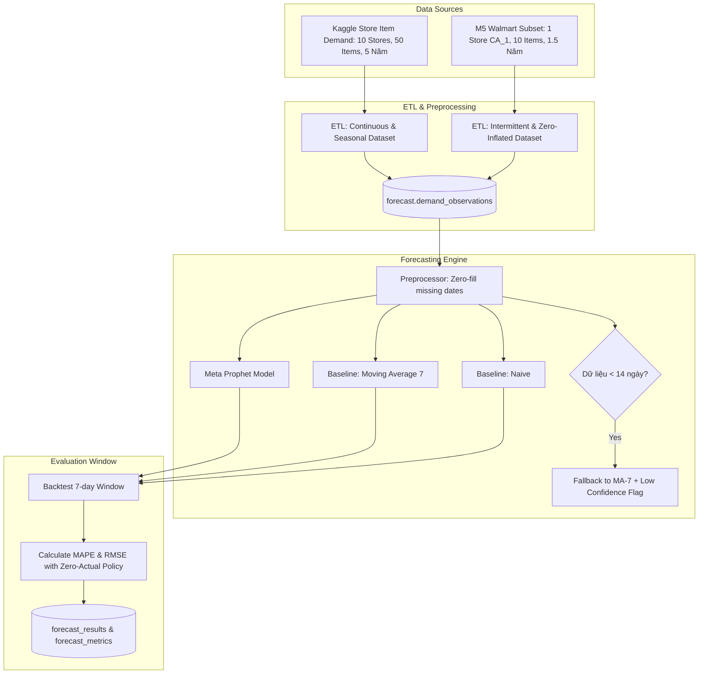

# Execution Plan: Demand Forecast Agent — Meta Prophet, Baseline Benchmarking & Copilot Tool Integration

Date: 2026-10-19

## Status

Active (chờ review trước khi triển khai)

## Outcome

Hệ thống LogiX có thành phần **Demand Forecast Agent** hoàn chỉnh, hoạt động theo mô hình kép (Dual-Mode):
1. **Dịch vụ Định lượng Độc lập (`forecast-service`)**: Microservice chuyên trách tính toán chuỗi thời gian (time-series forecasting) bằng **Meta Prophet**, hỗ trợ dự báo 7 ngày (`horizon_days=7`) theo từng cặp SKU-Kho-Ngày, sinh khoảng tin cậy (Confidence Interval: `lower_bound`, `upper_bound`), đối chứng tự động với hai baseline chuẩn **Moving Average 7 ngày (MA-7)** và **Naive Forecast**, đo lường sai số định lượng qua **MAPE** và **RMSE** với chính sách xử lý ngày có doanh số bằng 0 (Zero-Actual Policy) và cơ chế Fallback chống sập khi dữ liệu thưa thớt.
2. **Bộ Dữ liệu Thực nghiệm Khoa học**: Nạp và tiền xử lý 2 bộ dữ liệu chuẩn quốc tế phục vụ benchmark:
   - **Kaggle Store Item Demand Forecasting**: Đại diện cho nhu cầu liên tục (continuous, dense demand), có tính chu kỳ tuần/năm rõ rệt để chứng minh năng lực bắt trend & seasonality của Prophet.
   - **Tập con M5 Forecasting (Walmart)**: Đại diện cho nhu cầu ngắt quãng, thưa thớt (intermittent, lumpy, zero-inflated demand) để kiểm chứng cơ chế Fallback và Zero-actual policy.
3. **Tích hợp Tác nhân Trí tuệ Nhân tạo (`agent-service` / Planner Agent)**:
   - Bổ sung Tool Catalog `forecast.py` vào `ToolRegistry`: `get_sku_demand_forecast`, `trigger_demand_forecast`, `check_stockout_risk`.
   - Planner Agent (LangGraph) có năng lực gọi tool, phân tích tương quan giữa nhu cầu dự báo và tồn kho khả dụng (`available_quantity`), giải thích nguyên nhân tăng/giảm và đưa ra đề xuất nhập hàng (Advisory) bằng ngôn ngữ tự nhiên.
4. **Tích hợp Hướng sự kiện (Event-Driven Integration)**:
   - Tiếp nhận dữ liệu xuất bán từ sự kiện hoàn tất đơn hàng (`OrderConfirmed` / `DeliveryCompleted`) nạp vào `demand_observations` (idempotent).
   - Phát sự kiện `ForecastCompleted` qua Outbox Pattern lên Kafka sau khi hoàn thành phiên chạy.
5. **Giao diện Trực quan hóa (`LogiX-Frontend`)**:
   - Dashboard hiển thị biểu đồ chuỗi thời gian (Lịch sử, Dự báo Prophet, Vùng tin cậy, Đường MA-7).
   - Bảng so sánh chỉ số độ chính xác (MAPE/RMSE) và thẻ cảnh báo rủi ro thiếu hàng (Stockout Risk Alert).

---

## Context

- **Đề tài tốt nghiệp**: Nền tảng B2B Logistics tích hợp Agentic AI (`docs/plan_ghi_ro_so_task_backlog/de_cuong_do_an.md` - Mục 4, 6, 7).
- **Yêu cầu Nghiệp vụ (BRD)**:
  - `BO-03`: Báo cáo và so sánh tối thiểu với baseline trung bình trượt hoặc naive forecast.
  - `FR-FC-001`: Chạy forecast 7 ngày theo SKU-kho từ dữ liệu daily fulfilled demand.
  - `FR-FC-002`: Chạy baseline trên cùng tập dữ liệu và tính MAPE/RMSE khi đủ actual.
  - `FR-FC-003`: Hiển thị forecast, confidence interval, actual và model metadata.
  - `11.2 Demand Forecast`: Đơn vị dự báo `tenant + warehouse + SKU`, horizon 7 ngày, xử lý chuỗi actual=0, fallback khi thiếu dữ liệu, không tự động sinh lệnh nhập kho.
- **Tài liệu Kiến trúc**:
  - `docs/python-services-database-guide.md` (§10, §14: Thiết kế Forecast schema).
  - `docs/architecture/database-design.md` (§14 `logix_forecast`).
  - `docs/architecture/event-architecture.md` (Event `ForecastCompleted`, `OrderConfirmed`).
- **Hiện trạng mã nguồn**:
  - `apps/forecast-service/src/logix_forecast/modules/`:
    - `forecasts/models.py`: Đã có các bảng `forecast_runs`, `forecast_series`, `forecast_results`, `forecast_metrics`.
    - `demand/models.py`: Đã có bảng `demand_observations`.
    - `messaging/models.py`: Đã có bảng `inbox_events`, `outbox_events`.
    - Alembic migration `20260905_0001_initial_forecast_schema.py` đã sẵn sàng.
  - `apps/forecast-service/pyproject.toml`: Đã khai báo optional dependencies `forecast = ["prophet>=1.1.5", "pandas>=2.2.0", "numpy>=1.26.0"]`.
  - `apps/agent-service`: Đã hoàn thiện LangGraph Planner Agent (`modules/planner/`), `ToolRegistry` sẵn sàng tiếp nhận tool catalog mới.

---

## Scope

### In scope

- **Bộ nạp Benchmark Data (ETL Script)**:
  - Tải/xử lý file CSV từ **Store Item Demand Forecasting** và tập con **M5 Forecasting**.
  - Ánh xạ sang các thuộc tính `tenant_id`, `warehouse_id`, `product_id`, `demand_date`, `fulfilled_quantity`.
  - Nạp dữ liệu idempotent vào bảng `forecast.demand_observations`.
- **Lõi Toán học & Thuật toán Dự báo (`apps/forecast-service/src/logix_forecast/engine/`)**:
  - `preprocessor.py`: Lấp đầy ngày thiếu (Calendar Imputation / Zero-filling), tạo cấu trúc chuỗi đều đặn.
  - `prophet_model.py`: Huấn luyện Meta Prophet, xuất `predicted_quantity`, `lower_bound`, `upper_bound` với khoảng tin cậy 80%/95%, chặn biên dưới không âm.
  - `baselines.py`: Cài đặt Naive Forecaster và Moving Average 7 ngày (MA-7).
  - `metrics.py`: Tính MAPE và RMSE với chính sách `zero_actual_policy` chuẩn mực.
  - `fallback.py`: Tự động nhận diện chuỗi thưa thớt/ít dữ liệu (< 14 ngày) để chuyển hướng về MA-7 an toàn.
  - `pipeline.py`: Điều phối luồng xử lý end-to-end cho một chuỗi hoặc một tập chuỗi SKU-Kho.
- **Tầng Dịch vụ & REST API (`apps/forecast-service`)**:
  - `POST /api/v1/forecast/runs`: Kích hoạt phiên chạy dự báo mới (toàn bộ hoặc chọn lọc SKU/Kho).
  - `GET /api/v1/forecast/runs`: Danh sách lịch sử các phiên chạy, trạng thái, latency.
  - `GET /api/v1/forecast/runs/{id}`: Chi tiết phiên chạy và danh sách các series.
  - `GET /api/v1/forecast/results`: Lấy kết quả dự báo theo dải ngày, SKU, kho.
  - `GET /api/v1/forecast/metrics`: Lấy báo cáo so sánh chỉ số sai số giữa Prophet vs Baselines.
  - `GET /api/v1/forecast/stockout-risks`: Tính toán nhanh rủi ro cạn kho dựa trên tổng dự báo 7 ngày.
- **Tích hợp Agentic AI Copilot (`apps/agent-service`)**:
  - Tạo `modules/tools/catalog/forecast.py` gồm các `@tool`:
    - `get_sku_demand_forecast`: Tra cứu dự báo 7 ngày của sản phẩm tại kho.
    - `trigger_demand_forecast`: Kích hoạt chạy lại dự báo (Advisory).
    - `check_stockout_risk`: Phân tích rủi ro thiếu hàng bằng cách phối hợp `get_inventory_balance` và `get_sku_demand_forecast`.
  - Đăng ký vào `ToolRegistry` có kiểm tra quyền (RBAC).
  - Bổ sung Prompt Reasoning để Copilot giải thích xu hướng và đưa ra khuyến nghị thực tế.
- **Event-Driven & Outbox**:
  - Worker xuất bản sự kiện `ForecastCompleted` qua Outbox table.
- **Frontend Contract & Trực quan hóa**:
  - Tạo API client và các component biểu đồ dự báo (Recharts / Chart.js).
  - Thẻ đánh giá độ chính xác mô hình và thẻ cảnh báo hết hàng.

### Out of scope

- Các mô hình Deep Learning phức tạp (LSTM, Temporal Fusion Transformer) — giữ đúng trọng tâm nghiên cứu Prophet theo đề cương.
- Tự động sinh đơn nhập hàng (Purchase Order) hoặc tự ý thay đổi số liệu tồn kho (tuân thủ nguyên tắc Advisory của BRD).
- Dự báo mức độ mạng lưới liên kho (multi-echelon inventory optimization).

---

## Approach & Benchmark Strategy

### Chiến lược Dữ liệu Benchmark (Store Item + M5 Subset)

1. **Dataset 1: Store Item Demand Forecasting**:
   - Nhu cầu liên tục (Dense), tính mùa vụ theo tuần rất cao (cuối tuần bán mạnh hơn).
   - Dùng để kiểm chứng: Khả năng bắt kịp xu hướng (Trend) và chu kỳ ngày trong tuần (Weekly Seasonality) của Prophet vượt trội so với Moving Average.
2. **Dataset 2: M5 Forecasting Subset**:
   - Lọc 1 Store (`CA_1`) và 10 SKU (5 SKU nhóm `FOODS_3` bán chạy + 5 SKU nhóm `HOBBIES_1` bán ngắt quãng nhiều ngày = 0).
   - Dùng để kiểm chứng: Khả năng ứng phó với dữ liệu thưa thớt, kiểm chứng quy tắc tính MAPE khi Actual = 0, và kích hoạt cơ chế Fallback an toàn.

---

## Phase Breakdown

### Phase 1: Chuẩn bị Dữ liệu & Benchmark ETL Pipeline
1. Kích hoạt môi trường và kiểm tra schema database `logix_forecast`.
2. Tạo script `scripts/benchmark/ingest_benchmark_data.py`:
   - Hỗ trợ nạp cả 2 nguồn: Store Item CSV và M5 Subset CSV.
   - Gắn `tenant_id`, tạo mock `warehouse_id` và `product_id` tương ứng trong bảng dữ liệu mẫu.
   - Nạp vào bảng `forecast.demand_observations` với cơ chế kiểm tra trùng lặp qua `source_event_id` / `source_order_id`.
3. Cài đặt test xác thực: Đảm bảo dữ liệu sau khi nạp có thể truy vấn theo dải thời gian liên tục.

### Phase 2: Lõi Tính Toán Dự Báo (Core Forecasting Engine)
1. Cài đặt các module toán học trong `apps/forecast-service/src/logix_forecast/engine/`:
   - `preprocessor.py`: Đảm bảo không bị gián đoạn ngày (lấp đầy ngày 0).
   - `prophet_model.py`: Khởi tạo Prophet với `yearly_seasonality=False`, `weekly_seasonality=True`, `interval_width=0.80`, `floor=0`.
   - `baselines.py`: Naive ($y_{t+h} = y_t$) và MA-7 ($\frac{1}{7}\sum y$).
   - `metrics.py`:
     - $\text{RMSE} = \sqrt{\frac{1}{n}\sum (y_i - \hat{y}_i)^2}$
     - $\text{MAPE} = \frac{100\%}{k}\sum_{y_i > 0} \left|\frac{y_i - \hat{y}_i}{y_i}\right|$ (với chính sách ghi nhận `eligible_point_count`).
   - `fallback.py`: Kiểm tra điều kiện $N < 14$, chuyển về MA-7 nếu không đủ điều kiện chạy Prophet.
2. Viết Unit Tests kiểm tra độ chính xác toán học, các trường hợp biên (tất cả bằng 0, chuỗi ngắn, chuỗi có đột biến).

### Phase 3: Service Layer, REST API & Persistence
1. Cài đặt `ForecastService` trong `apps/forecast-service`:
   - Quản lý vòng đời `ForecastRun`: tạo run, chạy tuần tự/song song các series, lưu kết quả và metrics.
   - Tính toán `dataset_hash` (SHA-256) và đo `latency_ms` phục vụ audit.
2. Xây dựng FastAPI Router `/api/v1/forecast/`:
   - `POST /runs`, `GET /runs`, `GET /runs/{id}`.
   - `GET /results`: Query theo `warehouse_id`, `product_id`.
   - `GET /metrics`: Trả về so sánh Prophet vs Baselines.
   - `GET /stockout-risks`: Trả về danh sách SKU có tổng dự báo 7 ngày vượt ngưỡng an toàn.
3. Tích hợp Outbox Event: Tự động ghi bản ghi `ForecastCompleted` vào bảng `outbox_events` khi run thành công.

### Phase 4: Tích hợp Agentic AI Copilot (`agent-service`)
1. Tạo module `apps/agent-service/src/logix_agent/modules/tools/catalog/forecast.py`:
   - `@tool get_sku_demand_forecast`: Nhận `warehouse_id`, `product_id`, gọi qua `forecast-service` lấy kết quả 7 ngày.
   - `@tool trigger_demand_forecast`: Yêu cầu kích hoạt phiên tính toán mới.
   - `@tool check_stockout_risk`: Gọi đồng thời `inventory-service` (lấy tồn kho khả dụng) và `forecast-service` (lấy tổng nhu cầu 7 ngày tới) -> So sánh và cảnh báo số lượng thâm hụt nếu có.
2. Đăng ký vào `ToolRegistry` với permission `forecast:read` và `forecast:run`.
3. Bổ sung hướng dẫn vào system prompt của Planner Agent để Copilot biết cách trả lời:
   - Nêu rõ số lượng dự báo theo ngày và khoảng biến thiên (lower - upper).
   - So sánh với tuần trước (tăng/giảm bao nhiêu %).
   - Đưa ra lời khuyên nhập kho nếu phát hiện rủi ro thiếu hàng.

### Phase 5: Giao diện Trực quan hóa Frontend
1. Tạo trang `features/forecast/` trên `LogiX-Frontend`:
   - Bộ chọn Kho và Sản phẩm.
   - Biểu đồ đường (Line Chart): Lịch sử bán hàng + Đường dự báo Prophet + Dải tin cậy đổ bóng + Đường Baseline MA-7.
   - Card KPI So sánh sai số (MAPE/RMSE).
2. Tích hợp AI Copilot Chat Panel: Người dùng có thể hỏi trực tiếp trong khung chat và nhận biểu đồ tóm tắt kèm câu trả lời tự nhiên.

### Phase 6: Thử nghiệm Benchmark & Báo cáo Khoa học
1. Chạy thực nghiệm trên 2 tập dữ liệu (Store Item Demand và M5 Subset).
2. Xuất bảng dữ liệu đánh giá thực tế (Prophet vs MA-7 vs Naive).
3. Đóng gói kết quả thành báo cáo phục vụ thuyết minh đồ án tốt nghiệp.

---

## Decisions

- **2026-10-19: Chọn Meta Prophet làm mô hình cốt lõi**: Phù hợp tối đa với dữ liệu logistics bán buôn cấp ngày, dễ diễn giải thành phần trend/seasonality, hỗ trợ khoảng tin cậy tự nhiên và thời gian huấn luyện nhanh (~vài giây/chuỗi).
- **2026-10-19: Sử dụng 2 tập dữ liệu Benchmark quốc tế**: Store Item Demand (chuỗi trơn/liên tục) + Tập con M5 (chuỗi ngắt quãng/nhiều số 0) để tạo bằng chứng thực nghiệm khách quan, toàn diện cho đồ án.
- **2026-10-19: Chính sách Zero-Actual cho MAPE**: Khi $y_i = 0$, điểm dữ liệu này không thể chia được. Hệ thống sẽ bỏ qua điểm này khi tính phần trăm sai số, nhưng ghi nhận rõ tỷ lệ `eligible_point_count / total_point_count`, đồng thời bắt buộc sử dụng thêm **RMSE** làm thước đo phụ trợ không bị ảnh hưởng bởi giá trị 0.
- **2026-10-19: Ngưỡng kích hoạt Fallback**: Nếu chuỗi lịch sử có ít hơn 14 ngày quan sát, hệ thống từ chối huấn luyện Prophet và tự động chuyển sang Moving Average 7 ngày, gán nhãn `used_fallback = True`, `confidence_level = 0.50`.
- **2026-10-19: Giới hạn trách nhiệm của Agent (Advisory Only)**: Demand Forecast Agent chỉ cung cấp thông tin dự báo và cảnh báo nguy cơ, không được phép tự động gọi API tạo đơn nhập hàng hoặc tự thay đổi ngưỡng low-stock threshold trong Inventory Service.

---

## Risks And Recovery

| Rủi ro tiềm ẩn | Mức độ | Biện pháp Phòng ngừa & Khắc phục |
|---|:---:|---|
| **Cài đặt Prophet trên Windows/Docker bị lỗi C++ compiler / cmdstanpy** | Trung bình | Sử dụng bản pre-built wheel của `prophet` qua pip, hoặc chạy trong container Linux chuẩn (`python:3.12-slim` đã cài build-essential). |
| **Dữ liệu M5 quá nặng gây tràn bộ nhớ** | Cao | Áp dụng triệt để quy tắc trích xuất tập con (Subset): Chỉ lấy 1 Store (`CA_1`) và 10 SKU đại diện, tuyệt đối không nạp toàn bộ file 50 triệu dòng. |
| **Lỗi chia cho 0 khi chuỗi thực tế có ngày bán = 0** | Trung bình | Module `metrics.py` bắt buộc có bộ lọc `y_true > 0` cho MAPE và luôn tính kèm RMSE. |
| **Độ trễ khi huấn luyện Prophet thời gian thực** | Trung bình | Huấn luyện và tính toán theo cơ chế Background Job; API đọc dữ liệu đã tính sẵn từ bảng `forecast_results` để phản hồi người dùng trong < 50ms. |
| **Copilot tự bịa số liệu dự báo khi không có dữ liệu** | Cao | System prompt ràng buộc: Chỉ trả lời dựa trên kết quả trả về từ `get_sku_demand_forecast`. Nếu tool báo không có dữ liệu, thông báo rõ ràng cho người dùng. |

---

## Progress

### Phase 1: Benchmark Data & ETL
- [ ] Script trích xuất và nạp dữ liệu Kaggle Store Item Demand.
- [ ] Script trích xuất và nạp tập con M5 Forecasting (Store CA_1, 10 SKU).
- [ ] Kiểm thử dữ liệu đã nạp vào `forecast.demand_observations`.

### Phase 2: Core Forecasting Engine
- [ ] Cài đặt `engine/preprocessor.py` (Missing date imputation & zero-filling).
- [ ] Cài đặt `engine/prophet_model.py` (Prophet wrapper với confidence bounds).
- [ ] Cài đặt `engine/baselines.py` (Naive & Moving Average 7 ngày).
- [ ] Cài đặt `engine/metrics.py` (MAPE, RMSE & Zero-actual policy).
- [ ] Cài đặt `engine/fallback.py` (Fallback rule $N < 14$).
- [ ] Unit tests cho toàn bộ engine toán học.

### Phase 3: Service Layer & REST API
- [ ] Repository & Service quản lý vòng đời `ForecastRun`, `Series`, `Result`, `Metric`.
- [ ] FastAPI Router `/api/v1/forecast/runs`, `/results`, `/metrics`, `/stockout-risks`.
- [ ] Cơ chế sinh sự kiện Outbox `ForecastCompleted`.
- [ ] API integration tests & kiểm tra cách ly dữ liệu Multi-tenant.

### Phase 4: Copilot Agent Integration
- [ ] Xây dựng Tool Catalog `apps/agent-service/src/logix_agent/modules/tools/catalog/forecast.py`.
- [ ] Đăng ký Tool vào `ToolRegistry` kèm phân quyền RBAC.
- [ ] Thêm Tool `check_stockout_risk` (liên kết Inventory và Forecast).
- [ ] Tích hợp vào LangGraph Planner Agent và cấu hình Prompt Reasoning.
- [ ] Test hội thoại: Hỏi Copilot về dự báo nhu cầu và cảnh báo thiếu hàng.

### Phase 5: Frontend Dashboard & Chat Integration
- [ ] Trang Dashboard Forecast: Biểu đồ chuỗi thời gian, dải tin cậy, đường so sánh MA-7.
- [ ] Card đánh giá sai số MAPE/RMSE giữa các mô hình.
- [ ] Thẻ cảnh báo nguy cơ cạn kho (Stockout Alert).
- [ ] Tích hợp trả lời và hiển thị thông tin trực tiếp trong Copilot Chat UI.

### Phase 6: Đánh giá Thực nghiệm & Nghiệm thu
- [ ] Chạy benchmark độc lập trên 2 tập dữ liệu, lập bảng số liệu đối chiếu.
- [ ] Viết tài liệu kiến trúc kỹ thuật trong `docs/architecture/forecast-service-design.md`.
- [ ] Soạn nội dung chương thực nghiệm cho báo cáo đồ án tốt nghiệp.

---

## Validation

- **Focused Proof (Lõi Toán học & Thuật toán)**:
  - Prophet tạo đủ 7 ngày dự báo tương lai với `predicted_quantity >= 0`, `lower_bound <= upper_bound`.
  - Baseline MA-7 tính đúng trung bình 7 ngày quá khứ gần nhất.
  - Metrics MAPE và RMSE tính toán chính xác, không phát sinh lỗi ngoại lệ khi chuỗi có điểm 0.
  - Chuỗi có < 14 điểm quan sát tự động chuyển sang Fallback, đánh dấu `used_fallback = True`.
- **Integration Proof (Hệ thống & Tác nhân Copilot)**:
  - Gọi API `POST /api/v1/forecast/runs` chạy thành công, lưu đầy đủ dữ liệu vào `forecast_results` và `forecast_metrics`.
  - Sự kiện `ForecastCompleted` xuất hiện trong bảng `outbox_events` với đầy đủ envelope chuẩn.
  - Người dùng gửi câu hỏi trong Copilot: *"Dự báo tuần tới sản phẩm X ở kho Y thế nào? Có đủ hàng không?"* -> Agent tự động gọi `check_stockout_risk`, trả về câu trả lời chính xác dựa trên số liệu thực tế từ database.
  - Đảm bảo tính cách ly Multi-tenant: Tenant A không thể xem hoặc kích hoạt dự báo của Tenant B.
- **Repository-Required Checks**:
  - `pytest apps/forecast-service/tests` pass 100%.
  - `pytest apps/agent-service/tests` pass 100% (bao gồm các test tool forecast mới).
  - `ruff check` và `ruff format --check` trên toàn bộ mã nguồn không phát sinh lỗi.
