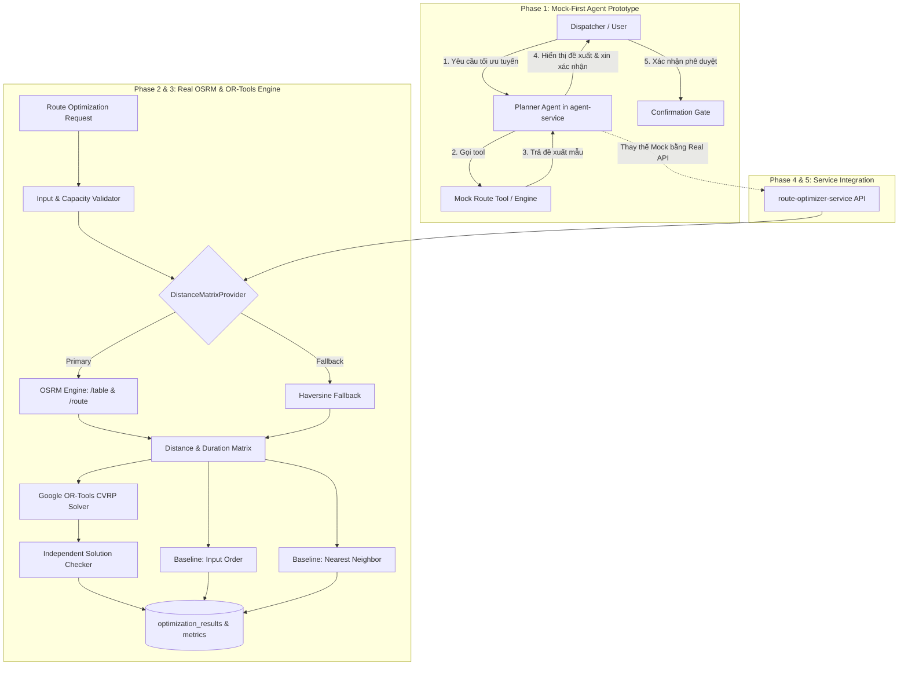

# Execution Plan: Route Optimizer Service — Mock-First Prototype, OSRM Road Network & Google OR-Tools Solver

Date: 2026-10-19

## Status

Active (Đã cập nhật chiến lược: **Mock-First cho Agent** + **OSRM đường bộ thực tế**)

## Outcome

`route-optimizer-service` sinh **phương án tuyến đề xuất (proposal)** cho một `DeliveryTrip`, tính toán trên **mạng lưới đường bộ thực tế (OSRM)** kết hợp bộ giải **Google OR-Tools CVRP**, có đối chứng khoa học với baselines và khả năng tái lập hoàn toàn. 

Đặc biệt, kế hoạch áp dụng chiến lược **Mock-First / Rapid Prototyping ngay từ Bước 1**:
- Cho phép **Planner Agent** có thể tự suy luận hoặc dùng dữ liệu mock để chạy thông suốt toàn bộ luồng hội thoại, tạo phương án tuyến mẫu và kích hoạt cổng phê duyệt (Confirmation Gate) ngay lập tức mà không bị nghẽn bởi tiến độ của `transport-service` hay việc dựng cụm OSRM.
- Từng bước thay thế Mock Provider bằng Real OSRM Provider và Real OR-Tools Solver thông qua mô hình kiến trúc `Strategy Pattern / Adapter Pattern` (tuân thủ BRD §11.1 và NFR-AI-004).

### Mục tiêu kỹ thuật cốt lõi:
1. **Mock-First Agent Prototype**: Cung cấp ngay kịch bản mô phỏng để Planner Agent phân tích yêu cầu điều phối, đề xuất thứ tự giao hàng trực quan, so sánh % tiết kiệm và yêu cầu người dùng phê duyệt trước khi dispatch.
2. **Mạng lưới đường bộ OSRM (Open Source Routing Machine)**:
   - Dùng OSRM Table API (`/table/v1/driving/`) làm **Primary Distance & Duration Matrix Provider** (độ chính xác theo đường giao thông thực tế, tính cả thời gian chạy xe `duration_seconds`).
   - Dùng OSRM Route API (`/route/v1/driving/`) để trích xuất hình học tuyến đường (`geometry / polyline`) phục vụ vẽ đường đi uốn lượn thực tế trên bản đồ frontend.
   - Giữ công thức **Haversine** làm **Fail-safe Fallback Provider** khi OSRM timeout hoặc không khả dụng (đáp ứng AT-10 & BRD §11.3).
3. **Bộ giải định lượng Google OR-Tools**:
   - Giải bài toán depot → stops → depot, kiểm tra ràng buộc tải trọng kép (`capacity_weight`, `capacity_volume`), mỗi stop phục vụ đúng 1 lần.
4. **Đối chứng Baselines khoa học**:
   - So sánh tự động với `INPUT_ORDER` (thứ tự nhập thủ công) và `NEAREST_NEIGHBOR` (thuật toán tham lam láng giềng gần nhất).
   - Tính toán và lưu chỉ số cải thiện `improvement_ratio` (BO-04).
5. **Tính toán tái lập & Kiểm tra độc lập**:
   - Ghi nhận `input_hash`, `osrm_version`, `solver_version`, `parameters`, `random_seed`.
   - Module `checker.py` độc lập kiểm chứng kết quả solver trước khi lưu.
6. **Tích hợp & Phân quyền**:
   - Dispatcher là người duy nhất có quyền Phê duyệt (`RouteApproved`) hoặc Override có lý do. AI chỉ đóng vai trò phân tích & đề xuất.

---

## Context

- **Đề tài tốt nghiệp**: Nền tảng B2B Logistics tích hợp Agentic AI (`docs/plan_ghi_ro_so_task_backlog/de_cuong_do_an.md` - Mục 2, 4, 6, 7).
- **Yêu cầu Nghiệp vụ (BRD)**:
  - `BO-04`: Tối ưu giao hàng, đo mức giảm quãng đường/chi phí so với thứ tự ban đầu hoặc nearest-neighbor.
  - `FR-ROUTE-001`: Tối ưu depot-to-stops-to-depot, không vượt capacity, mỗi stop đúng một lần.
  - `BR-TRIP-005`: Route Optimizer chỉ đề xuất. Dispatcher phê duyệt hoặc override có lý do.
  - `BR-AI-001`: LLM không tự tính toán số liệu định lượng; dùng mô hình/công cụ chuyên biệt.
  - `BR-AI-005`: Lưu input hash, solver/version, metrics để tái lập.
  - `11.3 Route Optimization`: Đầu vào depot, stops, distance matrix (OSRM), vehicle capacity; fallback khi solver lỗi.
  - `R-03`: Khoảng cách/tọa độ không ổn định -> sử dụng OSRM với dataset tọa độ cố định tại TP.HCM.
- **Hiện trạng mã nguồn**:
  - `apps/route-optimizer-service`: Đã có SQLAlchemy models (`optimization_runs`, `optimization_stops`, `optimization_results`, `optimization_metrics`, `inbox/outbox_events`), migration Alembic `20260905_0001_initial_route_optimizer_schema.py`.
  - `apps/agent-service`: Đã có LangGraph Planner Agent (`modules/planner/`), Confirmation Gate (`plan 2026-10-18`), `ToolRegistry` sẵn sàng đăng ký tool route mới.
  - `apps/transport-service`: Prisma schema đã có các bảng `DeliveryTrip`, `TripStop`, `RoutePlan`, `RoutePlanStop` — chưa có controller/service nghiệp vụ hoàn chỉnh (nên mock-first là chiến lược tối ưu nhất để tiến hành song song).

---

## Scope

### In scope

- **Phase 1 (Mock-First / Agent Prototype First)**:
  - Xây dựng `MockRouteEngine` và Mock Data Catalog (kịch bản giao hàng 5-10 điểm tại các quận TP.HCM).
  - Tích hợp ngay tool `propose_trip_route` vào Planner Agent trong `agent-service`:
    - Agent có khả năng phân tích prompt của Dispatcher, trả về phương án lộ trình tối ưu giả lập (thứ tự giao, tổng km, thời gian, % tiết kiệm so với baseline).
    - Tạo Preview Card và kích hoạt Cổng phê duyệt (Confirmation Gate).
  - Cho phép chạy demo và kiểm thử hội thoại tương tác người - máy hoàn chỉnh ngay Bước 1.
- **Phase 2 (OSRM Integration & Distance Engine)**:
  - Cài đặt `DistanceMatrixProvider` interface theo Abstract Base Class.
  - `OSRMProvider`: Gọi OSRM Table API (`/table/v1/driving/`) lấy distance matrix (mét) và duration matrix (giây); OSRM Route API (`/route/v1/driving/`) lấy geometry/polyline.
  - `HaversineProvider`: Dự phòng khẩn cấp khi OSRM service timeout hoặc gián đoạn mạng.
  - Bộ nhớ đệm (In-memory / Redis Cache) cho ma trận khoảng cách dựa trên hash cặp tọa độ.
- **Phase 3 (Google OR-Tools Solver & Baselines)**:
  - Cài đặt `ortools_solver.py` (RoutingIndexManager, RoutingModel, AddDimension cho weight và volume).
  - Cài đặt baselines: `input_order_route` và `nearest_neighbor_route`.
  - Module `checker.py`: Kiểm chứng tính khả thi độc lập (kiểm tra lặp stop, quá tải trọng, thứ tự khép kín).
- **Phase 4 (Service Layer, REST API & Persistence)**:
  - Triển khai FastAPI Router `/api/v1/route-optimizations` trong `route-optimizer-service`.
  - Lưu trữ đầy đủ kết quả vào database PostgreSQL (`optimization_runs`, `stops`, `results`, `metrics`).
  - Đảm bảo tính Idempotent theo `route_request_id` và Multi-tenant isolation.
  - Sửa lỗi startup fail-fast trong `main.py`.
- **Phase 5 (Chuyển đổi Tool Agent sang Real Service)**:
  - Thay thế Mock Provider trong `agent-service` bằng việc gọi REST API thực tế sang `route-optimizer-service`.
  - Kết nối với Confirmation Gate của Planner Agent cho hành động phê duyệt `approve_route`.
- **Phase 6 (Tích hợp Transport Service & Giao diện Bản đồ)**:
  - Phối hợp với `transport-service` lưu `RoutePlan PROPOSED`.
  - Giao diện Dispatcher trên Frontend: Bản đồ Leaflet/Mapbox hiển thị polyline đường bộ thực tế từ OSRM, bảng so sánh tuyến tối ưu vs baseline.
- **Phase 7 (Thực nghiệm & Báo cáo Benchmark)**:
  - Chạy benchmark trên tập CVRPLIB Augerat và tập kịch bản TP.HCM OSRM (10, 20, 30, 50 stops).
  - Đo lường latency giải thuật (mục tiêu ≤ 10s cho ≤ 50 stops theo NFR-AI-002) và mức độ tiết kiệm chi phí/quãng đường.

### Out of scope

- Điều hướng xe trực tiếp theo thời gian thực (Turn-by-turn navigation cho tài xế).
- Tích hợp tình trạng kẹt xe trực tiếp theo thời gian thực (Live traffic) — OSRM sử dụng profile tốc độ tiêu chuẩn.
- Tự động tách chuyến đa xe (Multi-trip / Multi-depot VRP) — MVP giới hạn 1 chuyến xuất phát từ 1 kho do 1 xe đảm nhiệm.

---

## Architecture & Data Flow



---

## Detailed Implementation Phases

### Phase 1: Mock-First Route Agent Prototype (Thực hiện ngay)

**Mục tiêu**: Unblock ngay luồng người dùng và Agentic AI, cho phép chạy kịch bản demo và kiểm thử hội thoại hoàn chỉnh mà không cần chờ OSRM server hoặc transport-service.

1. **Xây dựng Mock Route Tool trong `apps/agent-service`**:
   - Tạo file `apps/agent-service/src/logix_agent/modules/tools/catalog/route.py`.
   - Tool `propose_trip_route`:
     - Nhận đầu vào: `trip_id` (hoặc danh sách điểm giao).
     - Kiểm tra nếu chưa cấu hình `ROUTE_OPTIMIZER_SERVICE_URL` hoặc cờ `USE_MOCK_ROUTE=true`, tự động kích hoạt Mock Route Generator:
       - Sinh kịch bản giao hàng TP.HCM thực tế: Kho Tân Bình (Depot) → Quận 10 → Quận 3 → Quận 1 → Bình Thạnh → Phú Nhuận → Kho Tân Bình.
       - Tạo dữ liệu giả lập chi tiết: Thứ tự điểm ban đầu vs Thứ tự tối ưu.
       - Tính toán số liệu so sánh: Tổng quãng đường ban đầu: `28.4 km` → Sau tối ưu: `21.2 km` (tiết kiệm `25.3%`).
       - Thời gian dự kiến: `52 phút`.
       - Polyline mẫu để vẽ tuyến trên bản đồ.
   - Tool `get_route_plan_comparison`:
     - Trả về bảng đối chiếu giữa phương án tối ưu và 2 phương pháp đối chứng (Input Order và Nearest Neighbor).
2. **Tích hợp vào Planner Agent & Confirmation Gate**:
   - Đăng ký tool vào `ToolRegistry` với quyền `route:optimize` và `route:read`.
   - Bổ sung hướng dẫn vào System Prompt của Planner Agent:
     - Khi người dùng yêu cầu tối ưu chuyến hàng, phân tích thông tin chuyến xe, gọi `propose_trip_route`.
     - Trình bày kết quả rõ ràng: Thứ tự điểm giao mới, tổng quãng đường tiết kiệm được, cảnh báo tải trọng xe (ví dụ: đã dùng 850kg / 1000kg tải trọng).
     - **Không tự ý phê duyệt**: Luôn hỏi Dispatcher: *"Bạn có muốn phê duyệt lộ trình tối ưu này cho chuyến hàng không?"*
     - Khi người dùng đồng ý, kích hoạt Action `approve_route` qua cổng Confirmation Gate.
3. **Kiểm thử nghiệm thu Phase 1**:
   - Viết test case kịch bản hội thoại: User yêu cầu tối ưu -> Agent trả lời mạch lạc với số liệu so sánh -> User đồng ý -> Xác nhận thành công.

---

### Phase 2: OSRM Integration & Distance Engine (`route-optimizer-service`)

**Mục tiêu**: Xây dựng tầng tính toán khoảng cách và thời gian di chuyển đường bộ thực tế bằng OSRM, kèm cơ chế fallback an toàn.

1. **Thiết kế Abstraction Layer (`engine/distance/`)**:
   - `base.py`: Interface `DistanceMatrixProvider` định nghĩa phương thức:
     ```python
     async def get_distance_matrix(self, coordinates: list[tuple[float, float]]) -> DistanceMatrixResult:
         ...
     async def get_route_geometry(self, coordinates: list[tuple[float, float]]) -> RouteGeometryResult:
         ...
     ```
2. **Cài đặt `OSRMProvider` (`engine/distance/osrm.py`)**:
   - Gọi endpoint `/table/v1/driving/{coords}?annotations=distance,duration`.
   - Chuyển đổi tọa độ (lưu ý OSRM nhận `lon,lat`, chuẩn quốc tế thường là `lat,lon`).
   - Xử lý timeout (cấu hình `OSRM_TIMEOUT_SECONDS=5.0`) và retry có backoff.
   - Trích xuất ma trận khoảng cách (làm tròn số nguyên mét) và ma trận thời gian (giây).
   - Gọi endpoint `/route/v1/driving/{coords}?overview=full&geometries=geojson` để lấy đường polyline chi tiết cho các chặng (`legs`).
3. **Cài đặt `HaversineProvider` (`engine/distance/haversine.py`)**:
   - Tính khoảng cách đường chim bay theo bán kính trái đất $R = 6371000\text{ m}$.
   - Ước lượng thời gian di chuyển với vận tốc trung bình đô thị cấu hình (ví dụ $v = 30\text{ km/h}$).
   - Đóng vai trò Fallback khi OSRM down.
4. **Cài đặt `ResilientDistanceService`**:
   - Tự động gọi `OSRMProvider`, nếu gặp lỗi mạng/timeout/5xx thì tự động fallback sang `HaversineProvider`, đồng thời gán nhãn `distance_provider = "HAVERSINE_FALLBACK"` trong `model_metadata`.
   - Tích hợp LRU / In-memory Cache cho các ma trận đã tính để tăng tốc.

---

### Phase 3: Google OR-Tools CVRP Solver & Baseline Engine

**Mục tiêu**: Xây dựng thuật toán giải bài toán phân tuyến xe tải có ràng buộc sức chứa (CVRP).

1. **Cấu trúc Domain Models (`engine/domain.py`)**:
   - `Location`: `lat`, `lon`, tên/địa chỉ.
   - `StopNode`: `trip_stop_id`, `demand_weight`, `demand_volume`, tọa độ, `input_sequence`.
   - `VehicleSpec`: `capacity_weight`, `capacity_volume`, depot location.
   - `RoutingProblem`: tập hợp stops, vehicle, ma trận khoảng cách.
2. **Cài đặt Baselines (`engine/baselines.py`)**:
   - `InputOrderBaseline`: Đi tuần tự từ Depot → Stop 1 → Stop 2 → ... → Stop N → Depot. Tính tổng quãng đường và thời gian.
   - `NearestNeighborBaseline`: Bắt đầu từ Depot, tại mỗi bước chọn điểm chưa giao gần nhất (theo khoảng cách OSRM), kết thúc quay về Depot.
3. **Cài đặt `ORToolsSolver` (`engine/solver.py`)**:
   - Khởi tạo `pywrapcp.RoutingIndexManager` và `pywrapcp.RoutingModel`.
   - Đăng ký hàm chi phí chuyển tiếp (Transit Callback) dựa trên ma trận OSRM.
   - Bổ sung ràng buộc sức chứa kép (Capacity Dimensions):
     - `Capacity_Weight`: Không vượt quá `vehicle.capacity_weight`.
     - `Capacity_Volume`: Không vượt quá `vehicle.capacity_volume`.
   - Cấu hình chiến lược tìm kiếm:
     - First Solution: `PATH_CHEAPEST_ARC` hoặc `PARALLEL_CHEAPEST_INSERTION`.
     - Metaheuristic: `GUIDED_LOCAL_SEARCH`.
     - Time limit: cấu hình từ biến môi trường (mặc định 5s).
     - Cố định `random_seed` để bảo đảm tính tất định (Reproducibility).
4. **Cài đặt Solution Checker độc lập (`engine/checker.py`)**:
   - Kiểm tra 4 điều kiện bất biến (Invariants):
     1. Tuyến bắt đầu và kết thúc tại đúng Depot.
     2. Mỗi điểm giao trong danh sách xuất hiện chính xác 1 lần trong lộ trình.
     3. Tổng trọng lượng tại bất kỳ thời điểm nào không vượt tải trọng xe.
     4. Tổng thể tích tại bất kỳ thời điểm nào không vượt thể tích thùng xe.
5. **Unit Tests toàn diện**:
   - Test trường hợp 1 stop, nhiều stops (5, 10, 20 stops).
   - Test trường hợp quá tải (Infeasible) -> trả về mã lỗi rõ ràng `ROUTE_CAPACITY_EXCEEDED`.
   - Test so sánh: Quãng đường OR-Tools phải $\le$ Baseline Input Order.

---

### Phase 4: Service Layer, REST API & Database Persistence

**Mục tiêu**: Đóng gói thành Web API chuẩn mực trong `apps/route-optimizer-service`.

1. **Chuẩn hóa Khởi động & Cấu hình (`config.py` & `main.py`)**:
   - Cập nhật Pydantic Settings với đầy đủ cấu hình: `DATABASE_URL`, `OSRM_URL`, `SOLVER_TIME_LIMIT`, `MAX_STOPS`.
   - Sửa hàm `lifespan` trong `main.py`: Dừng ứng dụng ngay nếu không kết nối được Database (Fail Fast, không dùng `print` nuốt lỗi).
2. **FastAPI Endpoints (`api/v1/routes.py`)**:
   - `POST /api/v1/route-optimizations`:
     - Nhận payload tối ưu hóa (`depot`, `vehicle`, `stops`, `route_request_id`).
     - Kiểm tra Idempotency: nếu `route_request_id` đã được tính trước đó, trả lại kết quả ngay.
     - Thực hiện chạy tối ưu và lưu vào DB:
       - Bản ghi `optimization_runs` (trạng thái `SUCCEEDED` / `FAILED` / `INFEASIBLE`).
       - Chi tiết các chặng `optimization_stops`.
       - Kết quả tổng hợp `optimization_results` (kèm baseline value, `improvement_ratio`, geometry polyline từ OSRM).
       - Các chỉ số sai số/thời gian trong `optimization_metrics`.
   - `GET /api/v1/route-optimizations/{run_id}`: Lấy thông tin chi tiết một phiên chạy.
   - `GET /api/v1/route-optimizations/{run_id}/comparison`: Lấy bảng đối chiếu chuyên sâu OR-Tools vs Baselines.
3. **Outbox Pattern**:
   - Tự động ghi bản ghi sự kiện `RouteOptimized` vào bảng `outbox_events` sau khi lưu kết quả thành công.

---

### Phase 5: Nối Real Service vào Planner Agent (`apps/agent-service`)

**Mục tiêu**: Chuyển đổi Agent từ dùng Mock sang gọi Real Service hoàn chỉnh.

1. **Cập nhật Tool Catalog `route.py`**:
   - Sử dụng HTTP Client (có timeout và retry) gọi sang endpoint `POST /api/v1/route-optimizations`.
   - Map dữ liệu trả về thành cấu trúc trực quan cho LLM:
     - Danh sách thứ tự dừng (Stop Sequence kèm tên cửa hàng/địa chỉ).
     - Quãng đường tối ưu (km) và thời gian dự kiến (phút) theo OSRM.
     - So sánh: Tiết kiệm được bao nhiêu km và bao nhiêu % so với thứ tự ban đầu.
2. **Xác nhận Phê duyệt (Approval Gate)**:
   - Tool `approve_trip_route` gửi yêu cầu phê duyệt sang Transport Service (hoặc cập nhật trạng thái đã duyệt).
   - Kiểm tra chặt chẽ quyền RBAC của người dùng (`role == Dispatcher` hoặc `TenantAdmin`).

---

### Phase 6: Tích hợp Transport Service & Giao diện Bản đồ

1. **Tích hợp phía `transport-service`**:
   - Endpoint tiếp nhận đề xuất từ Route Optimizer và lưu bản ghi `RoutePlan` (status `PROPOSED`).
   - Endpoint cho Dispatcher duyệt (`RouteApproved`) hoặc ghi đè (`RoutePlanOverride` kèm lý do).
2. **Giao diện Web Dispatcher (`LogiX-Frontend`)**:
   - Tích hợp Leaflet / MapLibre:
     - Vẽ marker cho Depot và các điểm giao (đánh số theo thứ tự 1, 2, 3...).
     - Vẽ đường đi màu xanh theo polyline OSRM thực tế.
     - Vẽ đường đứt nét màu xám cho tuyến ban đầu (Input Order) để thấy rõ sự khác biệt tối ưu.
   - Bảng phân tích hành trình: Trọng lượng tích lũy qua từng điểm, thời gian ước tính đến từng điểm.
   - Nút bấm trực quan: "Phê duyệt lộ trình" và "Điều chỉnh thủ công (Override)".

---

### Phase 7: Benchmark Khoa học & Báo cáo Nghiệm thu

1. **Dataset Benchmark**:
   - **CVRPLIB Augerat Set A/P**: Đánh giá độ chính xác toán học của OR-Tools so với Best Known Solutions (BKS).
   - **TP.HCM Road Network Dataset (OSRM)**: Tập dữ liệu 5, 10, 20, 30, 50 điểm giao hàng thực tế tại các quận huyện TP.HCM.
2. **Script Thực nghiệm (`scripts/benchmark/route_benchmark.py`)**:
   - Đo lường tự động:
     - Quãng đường OSRM (km): OR-Tools vs Input Order vs Nearest Neighbor.
     - Tỷ lệ cải thiện trung bình (% improvement).
     - Thời gian giải (Solver Latency ms).
     - Tỷ lệ suy giảm khi chuyển đổi giữa OSRM và Fallback Haversine.
3. **Báo cáo thuyết minh**:
   - Xuất bảng biểu và đồ thị phục vụ bảo vệ đồ án tốt nghiệp.

---

## Decisions Summary

- **Mock-First Strategy**: Triển khai Mock Route Tool ngay tại Phase 1 để thông suốt trải nghiệm Agentic AI và kịch bản demo hội thoại ngay lập tức; sau đó hoàn thiện engine thật ở các phase tiếp theo.
- **OSRM làm Primary Distance Engine**: Sử dụng mạng lưới đường bộ thực tế qua OSRM Table API và Route API để tính quãng đường, thời gian và vẽ polyline chuẩn xác trên bản đồ.
- **Haversine làm Fail-safe Fallback**: Nếu OSRM down hoặc timeout, tự động lùi về Haversine, đảm bảo hệ thống không bao giờ bị dừng hoạt động (resilience).
- **Google OR-Tools**: Sử dụng thuật toán CVRP với ràng buộc tải trọng kép (trọng lượng + thể tích), tối ưu hóa quãng đường di chuyển.
- **Human-in-the-loop**: Route Optimizer và Agent chỉ giữ vai trò cố vấn/đề xuất (Advisory). Quyết định phê duyệt tuyến thuộc thẩm quyền duy nhất của Điều phối viên (Dispatcher).

---

## Progress Checklist

- [x] **Phase 1: Mock-First Route Agent Prototype**
  - [x] Xây dựng Mock Route Generator trong `apps/agent-service`.
  - [x] Tích hợp tool `propose_trip_route` & `get_route_plan_comparison`.
  - [x] Cấu hình Prompt Reasoning & Cổng phê duyệt Confirmation Gate.
  - [x] Test luồng hội thoại Copilot đề xuất tuyến đường mẫu.
- [x] **Phase 2: OSRM Integration & Distance Engine**
  - [x] Abstract class / Provider interface cho khoảng cách & thời gian.
  - [x] Cài đặt `OSRMProvider` (gọi Table API & Route API cho GeoJSON polyline).
  - [x] Cài đặt `HaversineProvider` (Fallback).
  - [x] Cơ chế Resilient Fallback (`ResilientDistanceService`).
- [ ] **Phase 3: Core OR-Tools Solver & Baselines (Tối ưu hóa nâng cao)**
  - [ ] Domain models cho bài toán CVRP.
  - [x] Cài đặt Baseline Input Order & Nearest Neighbor.
  - [ ] Cài đặt `ORToolsSolver` với ràng buộc tải trọng kép.
  - [ ] Bộ kiểm tra độc lập `SolutionChecker`.
  - [ ] Unit tests cho solver và baselines.
- [x] **Phase 4: Service Layer & REST API (Cung cấp tuyến đường - Phase 1)**
  - [x] Cập nhật cấu hình OSRM & xe trong `config.py`.
  - [x] Endpoint `POST /api/v1/route-optimizations` (tính toán tuyến đường & kiểm tra tải trọng).
  - [x] Endpoint `GET /api/v1/route-optimizations/sample` & `GET /api/v1/route-optimizations/{run_id}`.
  - [x] Sinh sự kiện Outbox và lưu trữ cơ sở dữ liệu khi có session.
- [x] **Phase 5: Agent Service Integration**
  - [x] Kết nối HTTP client gọi thực tế từ `agent-service` sang `route-optimizer-service`.
  - [x] Unit test kiểm thử gọi endpoint thực tế và parse schema `ProposedRouteOut`.
- [ ] **Phase 6: Transport Service & Frontend Map**
  - [ ] Tích hợp `transport-service` lưu `RoutePlan PROPOSED`.
  - [x] Bản đồ Leaflet vẽ polyline OSRM trên Frontend (`/routes`).
  - [x] Giao diện so sánh và nút bấm Phê duyệt / Ghi đè.
- [ ] **Phase 7: Thực nghiệm & Báo cáo Benchmark**
  - [ ] Chạy script benchmark CVRPLIB và TP.HCM OSRM.
  - [ ] Tổng kết số liệu % tiết kiệm quãng đường và độ trễ.
  - [ ] Hoàn thiện tài liệu kiến trúc.

---

## Validation & Proof

1. **Proof Phase 1 (Mock-First Agent)**:
   - Dispatcher chat với Agent: *"Hãy tối ưu tuyến giao hàng cho chuyến đi hôm nay"* -> Agent gọi tool mock, phản hồi danh sách các điểm dừng, quãng đường giảm từ 28.4km xuống 21.2km, hiển thị preview và chờ xác nhận.
2. **Proof Phase 2 (OSRM)**:
   - Kiểm thử gọi OSRM trả về ma trận khoảng cách đối xứng/bất đối xứng thực tế theo chiều đường và polyline GeoJSON hợp lệ.
   - Khi ngắt kết nối OSRM, hệ thống tự động fallback sang Haversine mà không báo lỗi 500.
3. **Proof Phase 3 (OR-Tools Solver)**:
   - Thuật toán giải ra tuyến đường hợp lệ: bắt đầu/kết thúc ở depot, ghé mỗi stop đúng 1 lần, tổng tải $\le$ capacity xe.
   - Quãng đường tối ưu của OR-Tools luôn $\le$ Baseline Input Order.
4. **Proof Phase 4 & 5 (Tích hợp & Độc lập)**:
   - API `POST /api/v1/route-optimizations` phản hồi trong $\le 10$ giây cho bài toán 50 stops.
   - Dữ liệu lưu đầy đủ vào các bảng `optimization_runs`, `results`, `metrics`.
   - Đảm bảo tính cách ly Multi-tenant giữa các doanh nghiệp.
